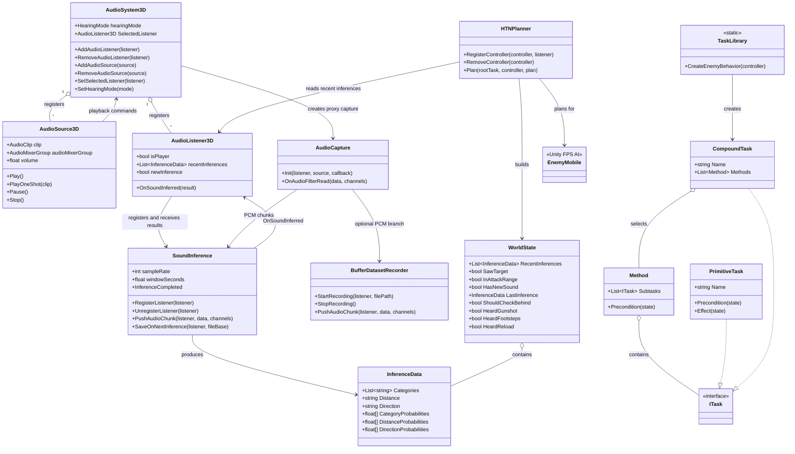
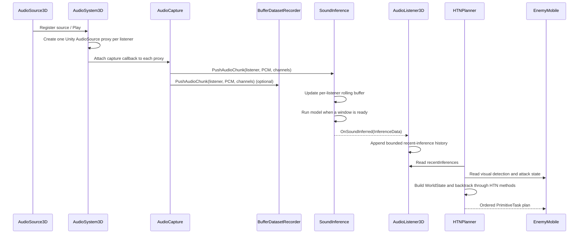

# Listening Agent

> The full project repository is private because it contains licensed third-party assets. This page documents the system architecture, implementation, and evaluation. A small demo executeable can be found in this folder. Source-code access can be arranged for serious hiring discussions, subject to third-party licensing restrictions.

## Learned auditory perception for Agents

> **One-line pitch:** I built a Unity prototype in which NPCs use a machine learning model to classify and spatially locate sounds, estimating their distance and direction, and use that perception to choose behaviour. The prototype provides the entire pipeline including dataset generation and import.

This study of mine, which I developed during my Master Thesis at the University of applied Sciences in Salzburg, explains the problem, the implementation, and the evaluation plan. The full Unity project is private because it contains licensed third-party assets. this document is designed to give enough context to understand the engineering work without requiring public redistribution of those assets. If more details are required please let me know and we can work out a way to get you access to a more detailed presentation or the thesis.

## Recruiter summary

This project combines some game programming with audio systems, machine learning inference, and behaviour planning. The core engineering challenge was to rapidly transform a continuous, spatial signal into a sufficiantly accurate classification while also enabling timely real-time decisions and keeping the user's audio experience separate from the signals consumed by NPCs.

The prototype demonstrates:

- a custom multi-listener 3D audio routing layer
- per-listener PCM capture and rolling inference buffers
- a sound inference training project using PyTorch
- a trained audio model deployed inside Unity through TorchSharp
- structured sound results containing category, distance, direction, and probabilities
- an HTN planner that combines auditory evidence with the existing FPS AI state
- dataset-generation and measurement tools for repeatable experiments

## Table of contents

- [1. Why I made this project](#1-why-i-made-this-project)
- [2. Questions I wanted to answer for myself](#2-questions-i-wanted-to-answer-for-myself)
- [3. What I built](#3-what-i-built)
- [4. My engineering contribution](#4-my-engineering-contribution)
- [5. Methodology and results](#5-methodology-and-results)
  - [Evaluation dimensions and their results](#evaluation-dimensions-and-their-results)
- [6. Technical architecture](#6-technical-architecture)
  - [System overview](#system-overview)
  - [UML class diagram](#uml-class-diagram)
  - [Runtime sequence](#runtime-sequence)
- [7. Implementation details](#7-implementation-details)
  - [Main code areas](#main-code-areas)
  - [Spatial audio](#spatial-audio)
  - [Capture and inference](#capture-and-inference)
  - [NPC reasoning](#npc-reasoning)
  - [Dataset and evaluation tooling](#dataset-and-evaluation-tooling)
  - [Data and control flow](#data-and-control-flow)
  - [Audio source to model](#audio-source-to-model)
  - [Inference to behaviour](#inference-to-behaviour)

## 1. Why I made this project

Originally I got the idea because characters in video games often detect sound through triggers, raycasts, or simple distance checks. Those mechanisms are useful, but they do not represent hearing as an interpreted perception. A trigger can say that something happened; it cannot naturally express that an NPC heard a likely gunshot from behind, is uncertain about its direction, or should investigate without immediately knowing the player's location.

This creates three practical problems:

1. **Auditory information is reduced too early.** A complex signal becomes a binary event instead of evidence with confidence and context.
2. **Player and NPC audio can become disconnected.** The player may hear a spatialised source while NPC logic receives a separate, hand-authored event.
3. **Behaviour needs uncertainty.** A useful NPC should react differently to a confident gunshot classification, an ambiguous direction, and silence.

Later on I also noticed, that this could possibly also be used for training robots in virtual environments.

## 2. Questions I wanted to answer for myself

- **Technical:** Can a sound inference model classify a listener's spatial audio stream while also running with acceptable latency and computational cost?
- **Gameplay:** Does giving NPCs interpreted sound information make their reactions feel believable and if so make them more responsive and believeable than trigger-only behaviour?

## 3. What I built

The project itself is an end-to-end pipeline rather than only a model demo:

```text
Add controlled sound clips
        ↓
Dataset generation and WAV recording
        ↓
External model training (PyTorch workflow)
        ↓
TorchScript model (`full_audio_model.pt`)
        ↓
Unity multi-listener audio routing
        ↓
Per-listener PCM buffers and inference
        ↓
Category + distance + direction (`InferenceData`)
        ↓
HTN planning and NPC behaviour
```

The model is only one part of the system. The surrounding code supplies spatial context, manages several listeners, exposes stable data contracts, and measures the cost of scaling the system.

## 4. My engineering contribution

| Challenge | Implemented approach | What this demonstrates |
| --- | --- | --- |
| Give each NPC its own hearing perspective (Unity natively only supports one `AudioListener` per scene) | `AudioSystem3D` creates and updates listener-specific Unity audio proxies. | Audio architecture, transforms, mixer routing, lifecycle management |
| Preserve raw audio for inference | `AudioCapture` forwards PCM blocks to the correct listener buffer. | Unity audio callbacks, data ownership, real-time constraints |
| Convert audio into gameplay information | `SoundInference` schedules rolling windows and publishes `InferenceData`. | Model integration, buffering, thresholds, event-driven design |
| Make perception useful to AI | `HTNPlanner` builds `WorldState` from recent inferences and visual state. | AI architecture, backtracking, separation of concerns |
| Make experiments repeatable | Dataset generation and `ModelPerfRamp` create labelled scenarios and CSV logs. | Experimental design, instrumentation, performance analysis |

## 5. Methodology and results

1. **Create a controlled data set for training.** Play labelled clips at known categories, distances, directions, and playback patterns.
2. **Train two different models externally.** The thesis workflow uses PyTorch to train audio models; the Unity project consumes the exported TorchScript model.
3. **Integrate the models into Unity.** Load the models through TorchSharp and run it against each listener's rolling buffer.
4. **Connect perception to behaviour.** Store results on `AudioListener3D`, construct `WorldState`, and let the HTN planner choose a plan.
5. **Measure technical performance.** Compare inference latency, FPS, CPU/GPU timings, and scaling as listener count increases.
6. **Evaluate believability.** Observe whether responses feel understandable, responsive, and context-sensitive rather than merely triggered.

### Evaluation dimensions and their results

| Dimension | Example measure | DCNN | CRNN |
| --- | --- | --- | --- |
| Model class. accuracy | Category correctness | 96.71% | 89.72% |
| Model dist. accuracy | Distance correctness | 51.64% | 71.03% | 
| Model dir. accuracy | Direction correctness | 62.44% | 60.75% | 
| Model overall accuracy | Category, distance, and direction all correct | 35.68% | 41.12% | 
| Direction accuracy (front) | Correctly detecting a sound from the front | 32.08% | 33.33% | 
| Direction accuracy (back) | Correctly detecting a sound from the back | 50.00% | 54.72% | 
| Direction accuracy (left) | Correctly detecting a sound from the left | 83.04% | 79.20% | 
| Direction accuracy (right) | Correctly detecting a sound from the right | 90.20% | 75.02% | 
| Distance accuracy (1 m) | Correct distance estimation at 1 meter | 92.45% | 92.59% | 
| Distance accuracy (15 m) | Correct distance estimation at 15 meters | 9.43% | 59.26% | 
| Inference time | Mean per-window model latency (median) | 3.13 ms (3.021 ms) | 3.72 ms (3.596 ms) | 
| System load | Mean FPS, 1 listener / 20 listeners | 591.57 / 423.88 FPS | 525.46 / 380.73 FPS | 
| FPS measure agreement | fps_mean vs. fps_inst correlation; mean difference; median difference; standard deviation | 0.6659; 9.35 FPS; -5.44 FPS; 74.36 FPS | 0.6058; 1.98 FPS; -23.14 FPS; 88.27 FPS | 

It should be mentioned that the accuracy weakness regarding front and back accuracy was to be expected, as Unity's sound renderer uses simple panning, which means it does not realistically differentiate between front, back, up and down. This is normally not a problem, as the user is moving and rotating the camera, compensating for this shortcomming.

## 6. Technical architecture

### System overview

The project is divided into four cooperating areas:

- **Spatial audio** creates a listener-specific representation of the world.
- **Capture and inference** converts PCM samples into `InferenceData`.
- **NPC reasoning** turns recent inferences into an HTN plan.
- **Tooling** generates datasets and measures accuracy/performance.

### UML class diagram

The diagram describes the project-specific classes. Unity components and the existing FPS framework are shown only where they are important to the data flow.



### Runtime sequence



## 7. Implementation details

### Main code areas

### Spatial audio

`AudioSystem3D` is the central registry. It maintains the active `AudioListener3D` and `AudioSource3D` components and creates a Unity `AudioSource` proxy for every listener/source pair. During `LateUpdate`, each proxy is positioned in listener space. This gives every NPC an independent spatial mix while still allowing all listeners to be processed in one scene.

`HearingMode.SelectedListenerOnly` controls what is audible to the human player. Non-selected listener proxies can be routed to silent mixer groups while remaining active for capture and inference. This separates **what the player hears** from **what NPCs can hear**.

`AudioSource3D` provides the scene-facing API (`Play`, `PlayOneShot`, `Pause`, and `Stop`) and delegates the actual playback bookkeeping to `AudioSystem3D`.

`AudioListener3D` owns the NPC-facing perception history. It registers with both the audio system and `SoundInference`, receives `InferenceData`, and retains a bounded list of recent results for the planner.

### Capture and inference

`AudioCapture` is attached to each generated Unity audio proxy. Its `OnAudioFilterRead` callback forwards PCM blocks to the inference manager and, when enabled, to the dataset recorder.

`SoundInference` maintains a separate circular buffer and scheduling state for every registered listener. Once a listener has a complete inference window, it:

1. Applies the configured silence gate when appropriate.
2. Converts the current audio window into the model input format.
3. Runs the TorchSharp model on the selected device.
4. Maps model outputs to category, distance, and direction labels.
5. Publishes the result to the listener and the `InferenceCompleted` event.

`InferenceData` is the small data contract between perception and behaviour. It contains human-readable labels as well as probability arrays, so a behaviour system can use either a discrete result or confidence-aware logic.

### NPC reasoning

`HTNPlanner` associates an `EnemyMobile` controller with its `AudioListener3D`. For each planning request it combines:

- recent auditory inferences;
- whether the enemy currently sees the target;
- whether the target is in attack range;
- time since the target was last seen; and
- whether a meaningful audio change has occurred.

Those values form a `WorldState`. `TaskLibrary` creates the enemy's compound behaviour tree. `HTNPlanner.PlanInternal` recursively evaluates methods, clones state for backtracking, and returns an ordered list of `PrimitiveTask` actions when a method succeeds.

The result is deliberately separated from the audio implementation: a different perception source could populate `WorldState` without rewriting the planner.

### Dataset and evaluation tooling

These components are support tools rather than the minimum runtime path:

| Component | Purpose |
| --- | --- |
| `BufferDatasetRecorder` | Records a listener's mixed PCM stream while preserving listener identity and writes WAV data. |
| `AudioRecorder` | Simple start/stop audio recorder used for capture experiments. |
| `AudioFolderPlayerAndRecorder` | Plays clips from a `Resources` folder and exports them as WAV files. |
| `SoundDatasetRuntimeGenerator` | Places sound sources at category/distance/direction combinations, records samples, and writes train/test CSV splits. |
| `ModelPerfRamp` | Increases the number of listeners, runs repeatable scenarios, and logs latency, accuracy, FPS, CPU, and GPU timing to CSV. |
| `SoundBeaconSpawner` | Interactive test harness for placing and toggling labelled sound sources in the scene. |
| `ChangeSampleRate` | Small experiment for changing Unity's audio configuration. |
| `BuildDebugLogger` | Displays Unity log output in a development build. |

### Data and control flow

### Audio source to model

The audio path is intentionally fan-out based:

```text
AudioSource3D
    └── AudioSystem3D proxy for listener A
          └── AudioCapture ──┬── SoundInference (listener A buffer)
                             └── BufferDatasetRecorder (optional)
    └── AudioSystem3D proxy for listener B
          └── AudioCapture ──┬── SoundInference (listener B buffer)
                             └── BufferDatasetRecorder (optional)
```

This keeps each listener's mixed signal separate. It also means that adding listeners increases the number of capture and inference paths, which is why `ModelPerfRamp` exists.

### Inference to behaviour

```text
InferenceData
    → AudioListener3D.recentInferences
    → HTNPlanner builds WorldState
    → TaskLibrary provides candidate methods
    → PrimitiveTask sequence
    → Existing EnemyMobile/FPS AI actions
```
